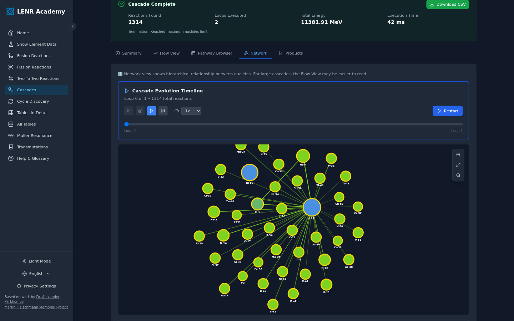
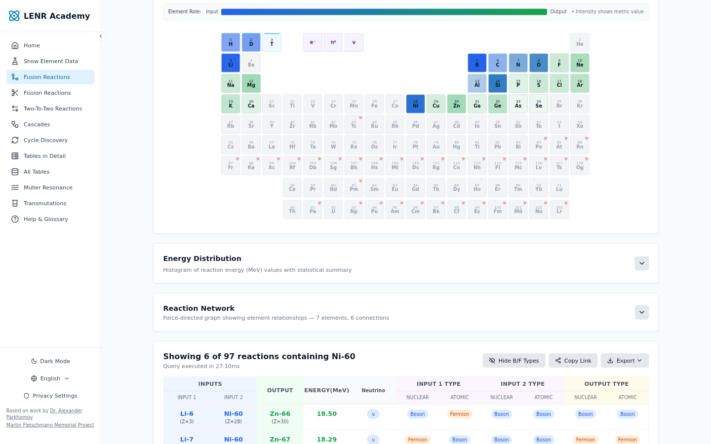
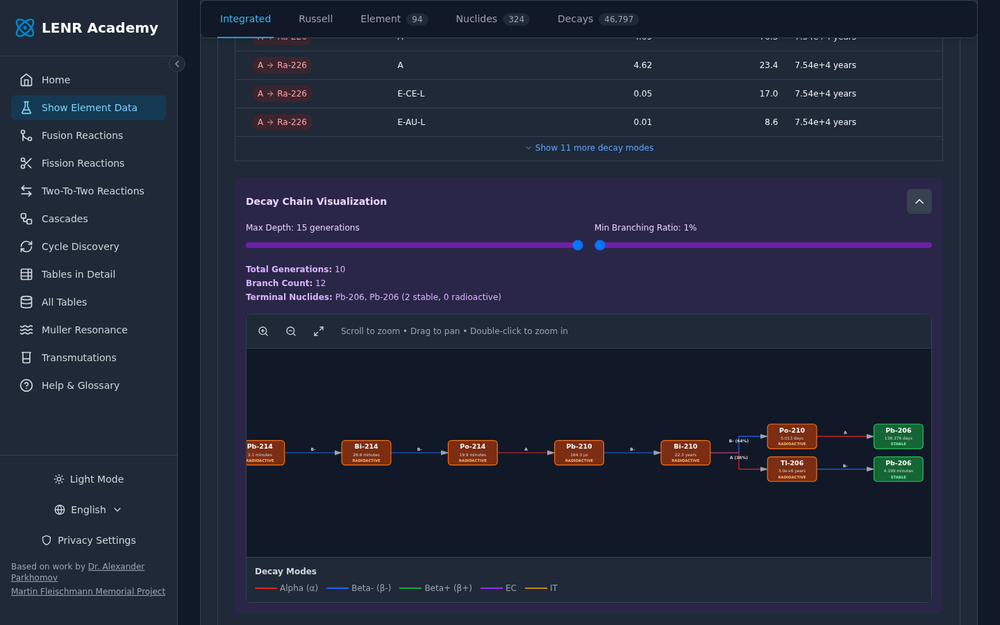
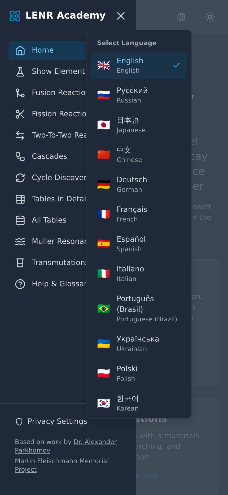
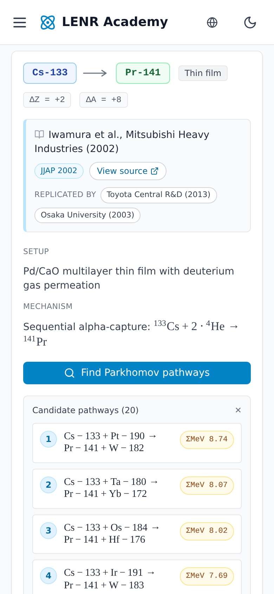
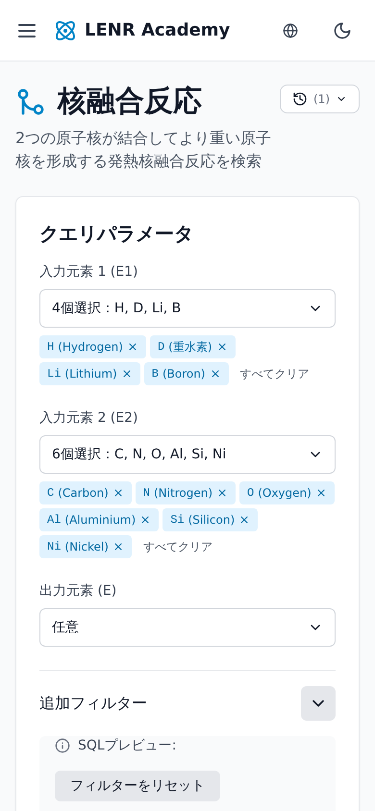

# LENR Academy

A modern web application for exploring Low Energy Nuclear Reactions (LENR) and cold fusion transmutation pathways. Built on Dr. Alexander Parkhomov's nuclear reaction databases, this tool provides interactive queries and analysis of thermodynamically favorable nuclear transmutations.

## Quick Links

| | |
|---|---|
| 🌐 **Production** | [lenr.academy](https://lenr.academy) |
| 🧪 **Beta** | [beta.lenr.academy](https://beta.lenr.academy) - Latest `main` with passing CI |
| 📋 **Project Board** | [View active development](https://github.com/orgs/Episk-pos/projects/1) |
| 💬 **Discussions** | [Community & support](https://github.com/Episk-pos/lenr.academy/discussions) |
| 📊 **Analytics** | [Public usage statistics](https://cloud.umami.is/analytics/eu/share/JGkYeKU60K9D1t4U?hostname=neq.localhost) |

## About

This application provides interactive tools for querying and analyzing a SQLite nuclear reaction database originally compiled by Dr. Alexander Parkhomov. The Parkhomov tables contain:

- **3,921 fusion reactions** (1,505 without neutrinos) - combining lighter nuclei
- **1,733 fission reactions** (818 without neutrinos) - splitting heavier nuclei
- **1,215,374 two-to-two reactions** (518,657 without neutrinos) - transforming pairs of nuclides

All reactions are exothermic (energy-producing) and represent thermodynamically favorable pathways for nuclear transmutation.

## Features

### Reaction queries
- **Fusion, Fission and Two-to-Two**: filter the Parkhomov tables by input/output elements, energy range and neutrino involvement, with a live SQL preview
- **Periodic-table heatmap**: see which elements appear in the results, coloured by frequency, energy or diversity
- **Pinned details**: pin an element or nuclide to filter the results and open its details card

### Pathways & dynamics
- **Cascades**: simulate chain reactions from a fuel mix and explore them as a summary, flow view, pathway browser, network graph or product chart
- **Cycles**: discover catalytic cycles whose intermediates are regenerated
- **Transmutations**: documented LENR transmutation claims from primary sources, each paired with candidate pathways from the database

### Nuclear data
- **Element & nuclide data**: chemical, physical and nuclear properties, with integrated, Russell, element, nuclide and decay views
- **Decay chains**: interactive multi-generation decay trees with adjustable depth and branching threshold
- **Segre chart**: zoomable chart of nuclides (Z vs N), coloured by stability
- **Muller Resonance**: electron-proton wavelength resonances between elements, cross-referenced with the reaction tables

### Power tools
- **All Tables**: run custom SQL against every table in the browser
- **Tables in Detail**: schema and field descriptions for each table
- **Export**: download results as CSV, JSON or PDF

### Reach & accessibility
- **14 languages**, with native-language switching
- **Dark and light themes**
- **Offline-ready**: the database is cached in IndexedDB after the first download
- **Installable PWA**
- **Privacy controls** for analytics and error reporting

## Screenshots

### Desktop

*Cascades: simulate chain reactions from a fuel mix (here H-1, Li-7, Ni-58) and explore the resulting reaction network.*

*Fusion query: a periodic-table heatmap of the results, filtered to reactions involving the pinned nuclide Ni-60.*

*Decay chains: Th-230 traced through 10 generations to stable Pb-206, including the Bi-210 branch.*

### Mobile

  
  
  

*Mobile: navigation and language switcher, candidate pathways for a documented transmutation, and the fusion query in Japanese.*

> 📸 **Screenshots are auto-generated** with Playwright. To regenerate them, start the dev server (`npm run dev`) and run `npm run screenshots` (set `BASE_URL` if the server isn't on `http://localhost:5199`).

## Database

The application uses a **161MB SQLite database** (`parkhomov.db`) containing all nuclear reaction data. The database is:

- **Format**: SQLite 3.x
- **Size**: 161 MB (uncompressed)
- **Tables**: NuclidesPlus, ElementPropertiesPlus, FusionReactions, FissionReactions, TwoToTwoReactions
- **Hosted**: [db.lenr.academy](https://db.lenr.academy/) - versioned storage with S3
- **Download**: Available in [GitHub release assets](https://github.com/Episk-pos/lenr.academy/releases/latest) for offline use or external analysis

The database runs entirely client-side in your browser using [sql.js](https://sql.js.org/) (SQLite compiled to WebAssembly). It's automatically cached in IndexedDB for faster subsequent loads.

### Database Versions

All database versions are available at **[db.lenr.academy](https://db.lenr.academy/)** with:
- Human-readable version browser
- API access at [versions.json](https://db.lenr.academy/versions.json)
- Direct downloads of any version
- MD5 checksums for verification

## Data Sources

Based on the groundbreaking work of:
- **Dr. Alexander Parkhomov** - Original Parkhomov tables (2018)
- **Martin Fleischmann Memorial Project** - Data compilation and research
- **R.W. Greenyer and P.W. Power** - Original [Nanosoft Package](https://nanosoft.co.nz) (PHP application)

## Credits & Attribution

This is a modern reimplementation of the original **Nanosoft Package** PHP web application developed by **R.W. Greenyer** and **P.W. Power**. We are grateful for their pioneering work in making LENR research accessible to the scientific community.

**Original Application**: [nanosoft.co.nz](https://nanosoft.co.nz)

## Support & Troubleshooting

Having issues? Check our troubleshooting guide:

- 🔧 **[Troubleshooting Guide](docs/TROUBLESHOOTING.md)** - Common issues and solutions (Safari/iOS errors, loading problems, performance)
- 💬 **[GitHub Discussions](https://github.com/Episk-pos/lenr.academy/discussions)** - Ask questions and get community support
- 🐛 **[Report a Bug](https://github.com/Episk-pos/lenr.academy/issues/new)** - Found an issue? Let us know!

## For Developers

Interested in contributing or running locally?

- 📖 **[Contributing Guide](CONTRIBUTING.md)** - How to contribute, setup instructions, development workflow
  - Using an LLM coding assistant? [CLAUDE.md](CLAUDE.md) is loaded automatically by [Claude Code](https://claude.ai/code), [Cursor](https://cursor.com), and similar tools — it covers architecture plus contributor knowledge (CI gotchas, review patterns, codebase conventions).
- 🛠️ **[Developer Documentation](docs/DEVELOPMENT.md)** - Architecture, technology stack, deployment guides
- 💬 **[GitHub Discussions](https://github.com/Episk-pos/lenr.academy/discussions)** - Ask questions and share ideas

## Development Roadmap

Active development is tracked on our [Project Board](https://github.com/orgs/Episk-pos/projects/1). See [GitHub Issues](https://github.com/Episk-pos/lenr.academy/issues) and [Milestones](https://github.com/Episk-pos/lenr.academy/milestones) for detailed planning.

## License

This project is licensed under the **GNU Affero General Public License v3.0 (AGPL-3.0)** - see the [LICENSE.md](LICENSE.md) file for details.

This is an open science project. All data and code are publicly available to advance LENR research.
